# Rediseño del visor (historia #185)

Propuesta para revisar con el fundador **antes de construir**. Las decisiones técnicas irán en un ADR.

## 1. Qué falla hoy

| Escritorio, inicio | Móvil, inicio |
|---|---|
| 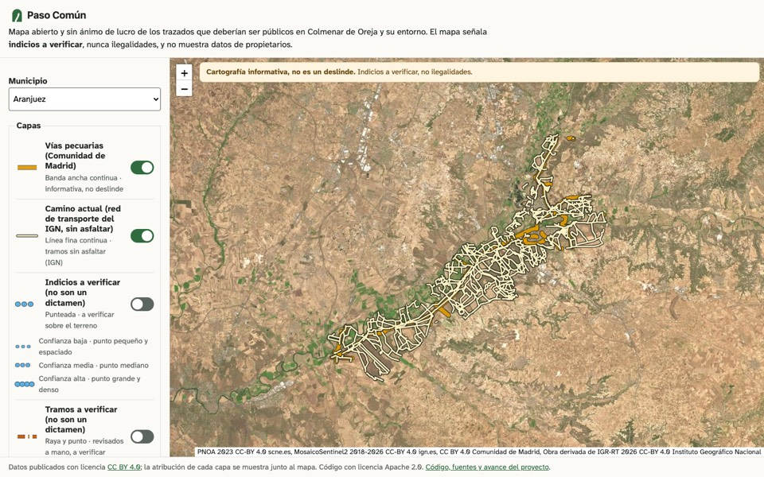 | 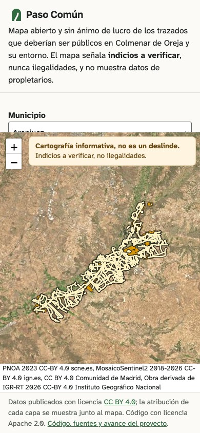 |

| Escritorio, ficha de un indicio | Móvil, ficha de un indicio |
|---|---|
| 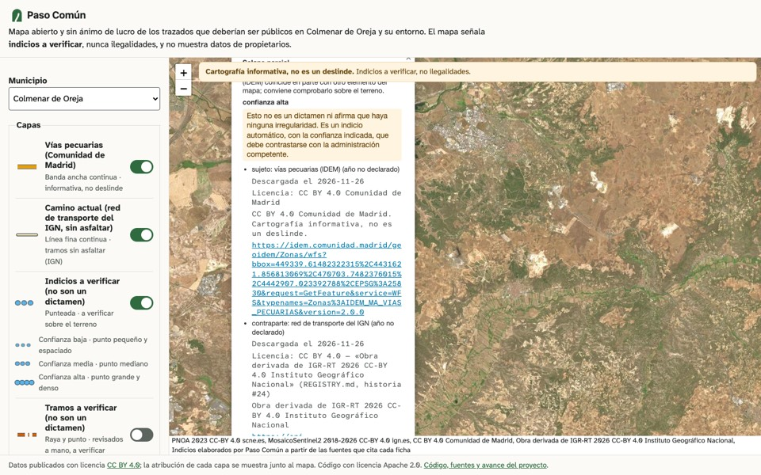 | 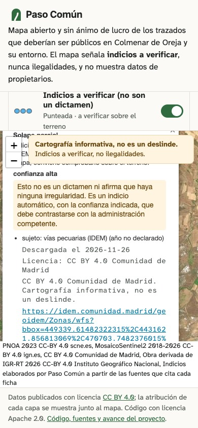 |

1. **No hay España.** Abre en Aranjuez (el primero del índice), sin contexto de dónde está ni de qué cubre el proyecto. Nada dice que el resto del país aún no tiene cobertura.
2. **El popup es ilegible.** Se abre encima del trazado y lo tapa, se corta por arriba (el título no se ve), mezcla tres tipografías y enseña URL de 300 caracteres en monoespaciada. En móvil ocupa toda la pantalla y no se puede cerrar bien.
3. **Móvil roto.** La cabecera y el párrafo de presentación se comen media pantalla; el mapa se monta encima del selector de municipio, y el panel de capas queda inaccesible debajo.
4. **El panel pesa más que el mapa.** Nombres de capa de tres líneas, la leyenda de confianza ocupa tanto como las capas y el selector es un `<select>` sin búsqueda.
5. **Atribución en una línea interminable** que tapa el borde inferior del mapa.
6. **La ortofoto lo llena todo.** A escala de municipio, los trazados en crema sobre la ortofoto marrón son una maraña sin jerarquía.

## 2. Principios

- **El mapa es la página.** Ocupa toda la pantalla; los controles flotan encima, en tarjetas.
- **Primero el resumen, luego el detalle.** Ningún texto largo a la vista sin pedirlo.
- **Lenguaje de indicio, siempre visible.** El aviso no se esconde nunca; solo se compacta.
- **Pocas funciones, bien hechas**: elegir municipio, encender capas, leer una ficha, compartir el enlace. Nada más en esta historia.
- **Móvil primero** (390 px), luego escritorio; claro y oscuro; AA.

## 3. Estructura de pantalla

### Escritorio (≥ 900 px)

```
┌──────────────────────────────────────────────────────────────────────────────┐
│ ┌─────────────────────────┐                                ┌───────────────┐ │
│ │ ◢ Paso Común            │                                │ FICHA (panel) │ │
│ │ ┌─────────────────────┐ │                                │ 400 px        │ │
│ │ │ 🔍 Buscar municipio │ │      MAPA A PANTALLA COMPLETA  │ se abre al    │ │
│ │ └─────────────────────┘ │                                │ pulsar un     │ │
│ │ Colmenar de Oreja   ✕   │                                │ trazado       │ │
│ │ ───────────────────     │                                │               │ │
│ │ CAPAS                   │                                │               │ │
│ │ ▬ Vías pecuarias    ●── │                                │               │ │
│ │ ─ Camino actual     ●── │                                │               │ │
│ │ ••• Indicios (19)   ──○ │                                │               │ │
│ │ ‒·‒ Tramos (40)     ──○ │                                │               │ │
│ │ ───────────────────     │                                │               │ │
│ │ Fondo: [Mapa|Ortofoto]  │                                └───────────────┘ │
│ └─────────────────────────┘                          [+][−][⌂ España]        │
│ ┌ Indicios a verificar, no ilegalidades · Cartografía informativa ─┐ (i) Atrib│
└──────────────────────────────────────────────────────────────────────────────┘
```

- **Tarjeta de control** (arriba a la izquierda, 320 px): logo, buscador, municipio actual, capas con su leyenda integrada (la muestra de cada línea *es* la leyenda) y conmutador de fondo. Plegable a solo el buscador.
- **Panel de ficha** (derecha, 400 px), se abre al pulsar un trazado; el trazado queda resaltado y visible a su izquierda. Se cierra con ✕ o `Esc`.
- **Franja de aviso** abajo, fija, una línea: «Indicios a verificar, no ilegalidades · Cartografía informativa, no es un deslinde».
- **Atribución** abajo a la derecha, compacta, en varias líneas cortas (la de cada capa encendida, como hoy). Sigue siempre visible.

### Móvil (390 px)

```
┌──────────────────────────┐
│ ┌──────────────────────┐ │   Barra superior: logo + buscador en una sola píldora.
│ │◢ 🔍 Colmenar de Oreja│ │
│ └──────────────────────┘ │
│                          │
│          MAPA            │
│                          │
│                  [⌂][◱]  │   ⌂ = ver España · ◱ = fondo
│ Indicios a verificar… (i)│   Aviso en una línea + atribución plegada en (i)… ver nota
├──────────────────────────┤
│ ═══                      │   HOJA INFERIOR con tres alturas:
│ Capas · 4          ▲     │   · plegada: título + botón
│                          │   · media: capas (o resumen de la ficha)
└──────────────────────────┘   · completa: detalle de la ficha
```

- Una sola **hoja inferior** que hace de panel de capas y de ficha. Al pulsar un trazado, la hoja sube a media altura con el **resumen**; «Ver detalle» (o arrastrar) la lleva a altura completa.
- Nota sobre la atribución en móvil: hoy es obligatorio que se vea junto a los datos. En móvil propongo mostrarla entera **en la hoja de capas** (junto a cada capa) y en el mapa una línea corta con las del mapa base. Si no te parece suficiente, se queda entera sobre el mapa como hoy.

## 4. España y la cobertura

- **Vista inicial: toda España** sobre un fondo cartográfico gris y tranquilo: el *Callejero gris* del IGN (`IGNBase-gris`, WMTS, CC BY 4.0 scne.es; verificado hoy con una petición real). La ortofoto queda como segundo fondo, a un toque.
- **Lo cubierto se resalta, lo demás en gris**: un velo gris sobre todo el mapa con «huecos» en los 7 municipios cubiertos, que se ven con el contorno en verde de la marca. A escala de España, 7 municipios son unos píxeles: se marca la zona con una **etiqueta-chincheta** «Primer hito · 7 municipios» que lleva a ella.
- Leyenda de cobertura en la tarjeta: «■ Con datos · ▒ Aún sin cobertura».
- Al buscar o pulsar un municipio cubierto, el mapa vuela a él y carga sus capas. Un municipio sin cobertura no se puede buscar todavía (no hay lista nacional); el buscador dice «Aún sin cobertura: por ahora, 7 municipios del sureste de Madrid» y los lista.
- **Hace falta un fichero nuevo**: los contornos de los 7 municipios, simplificados, en `site/datos/cobertura.geojson` con su `.procedencia.json`. Sale de la caché del IGN (unidades administrativas, CC BY 4.0 ign.es, «Publicar» en `REGISTRY.md`) con un comando nuevo `publicar-cobertura`, sin red. Peso estimado: < 60 KB.

## 5. La ficha

Panel lateral (escritorio) u hoja inferior (móvil). Nunca popup.

```
┌─────────────────────────────────────┐
│ INDICIO A VERIFICAR            ✕    │  ← tipo, en versalitas
│ Solape parcial                      │  ← etiqueta (título)
│ ●●● Confianza alta                  │  ← insignia con la muestra de la línea
│                                     │
│ Indicio a verificar: según vías     │  ← texto validado (#16/#169), tal cual
│ pecuarias (IDEM)… conviene          │
│ comprobarlo sobre el terreno.       │
│ ┌─────────────────────────────────┐ │
│ │ ⚠ Esto no es un dictamen ni …   │ │  ← aviso, SIEMPRE, sin plegar
│ └─────────────────────────────────┘ │
│ [⤢ Acercar]  [🔗 Copiar enlace]     │
│                                     │
│ ▸ Imágenes de comparación (2)       │  ← solo tramos; 2 columnas, año encima
│ ▸ Fuentes (2)                       │  ← tarjeta por fuente: papel, fuente,
│ ▸ Cómo se ha calculado              │     año, licencia, «Abrir consulta ↗»
└─────────────────────────────────────┘
```

- El **resumen** es el texto validado y el aviso: no se reescriben ni se acortan (están protegidos por hash). Lo que se pliega es lo demás.
- Las URL dejan de mostrarse enteras: el enlace dice «Abrir la consulta original ↗» (la URL completa queda en el `href` y en el título del enlace).
- Las fichas de vías pecuarias y camino actual son de tres líneas (capa, nombre, fuente) y usan el mismo panel.
- Varios trazados bajo el dedo: se abre el de más arriba (tramo > indicio > camino > vía), como hoy.

## 6. Capas y leyenda

- Nombres cortos en negrita («Vías pecuarias», «Camino actual», «Indicios a verificar», «Tramos a verificar»), con la descripción y la fuente en gris debajo, y el recuento del municipio («19 indicios»). La salvedad «no son un dictamen» sigue en la fila de los indicios y de los tramos.
- La confianza de los indicios se explica en una sola línea con tres muestras: «baja · media · alta».
- Indicios y tramos siguen **apagados al cargar** (decisión ya tomada).

## 7. Enlaces que se comparten

`?municipio=28043&tramo=4bb7d47423d242f7` abre el municipio con la ficha del tramo o indicio y lo encuadra. Sin parámetros, España. El botón «Copiar enlace» de la ficha copia esa URL. Si el tramo se pide, su capa se enciende.

## 8. Estados

| Estado | Qué se ve |
|---|---|
| Cargando índice | Mapa de España; tarjeta con esqueleto gris. |
| Cargando capas | Barra de progreso fina en cada fila de capa (como hoy). |
| Capa vacía | «Sin indicios publicados en este municipio», en gris. |
| Error de capa | Fila en tono nota (sin rojo) + aviso breve flotante «No se pudo cargar…». |
| Error de índice | Tarjeta: «No se pudo cargar la lista de municipios. Recarga la página.» |
| Mapa base caído | Fondo neutro y aviso en una línea (como hoy). |
| Sin cobertura | Velo gris + texto «Aún sin cobertura» en el buscador y la leyenda. |
| Enlace con tramo inexistente | Abre el municipio y dice «Ese tramo ya no está publicado». |

## 9. Técnica (irá al ADR)

- **Sigue Leaflet 1.9.4.** Todo es ráster WMTS + GeoJSON pequeño; MapLibre no aporta lo bastante para justificar el cambio.
- Se mantiene la arquitectura de módulos: `mapa.js` (único con Leaflet), `controlador.js` (puro), `vista.js` (DOM inyectado), `app.js` (composición). Nuevos módulos puros: `enlace.js` (leer y escribir la URL) y `cobertura.js` (velo y contornos).
- Popups de Leaflet: fuera. El clic llama a `alSeleccionar(id, propiedades)` y la vista pinta el panel.
- Fondo nuevo `IGNBase-gris`: alta en `REGISTRY.md` y en `NOTICE`, atribución «CC BY 4.0 scne.es» (pendiente de leer el texto exacto en la tabla de productos del SCNE).
- Python: comando `publicar-cobertura` (caso de uso + escritor), reutiliza `MunicipalBoundaryPort` y su caché; ADR con la licencia y el peso.
- Tests: los de #85, #95, #114, #166, #171 y #178 que fijan el marcado viejo (popups, `<select>`, clases) se reescriben para lo nuevo; las invariantes (aviso, vetadas, catastro, atribución, capas apagadas, rutas) se mantienen.

## 10. Decisiones tomadas (2026-11-27)

El fundador aprobó la propuesta sin elegir en las tres preguntas; se aplicó la opción más prudente en cada una y queda para revisar con su feedback:

1. **Fondo**: gris en España; al entrar en un municipio pasa solo a ortofoto, salvo que la persona haya elegido fondo.
2. **Atribución en móvil**: entera sobre el mapa, como hoy (no se toca la invariante).
3. **Tema**: sigue al sistema; sin conmutador.

Cambios respecto a la propuesta, al construir:

- Las filas de indicios y tramos conservan el nombre validado completo («… (no son un dictamen)», #169); solo se acortan vías pecuarias y camino actual.
- El lema «Señala indicios a verificar, nunca ilegalidades» va bajo el logo en escritorio; en móvil lo dice el aviso del mapa, que pasa a estar bajo la barra de búsqueda (abajo quedan la atribución y las hojas).
- El resumen de la medición de los tramos sigue entero en la fila de la capa (validado, #171). Candidato a plegarse si estorba.

Primera ronda de feedback del fundador (2026-11-27), aplicada en la misma PR:

- El resumen de la medición de los tramos se pliega («Cómo se ha medido»), para ver todas las capas a la vez.
- Sobre la ortofoto se ponen los rótulos del IGN (pueblos, carreteras), en grises, para no desorientarse al entrar en un municipio.
- En modo oscuro el mapa gris ya no se invierte (quedaba muy oscuro) y el velo es más suave.
- Revisión de la PR: en móvil las hojas abiertas repiten en su pie las atribuciones, que el mapa deja tapadas.

Las decisiones técnicas están en el [ADR 0051](../adr/0051-rediseno-del-visor-espana-y-cobertura-ficha-en-panel-y-fondo-ign-base-gris.md).

## 11. Resultado

| Escritorio, España (claro) | Escritorio, Colmenar (oscuro) |
|---|---|
| 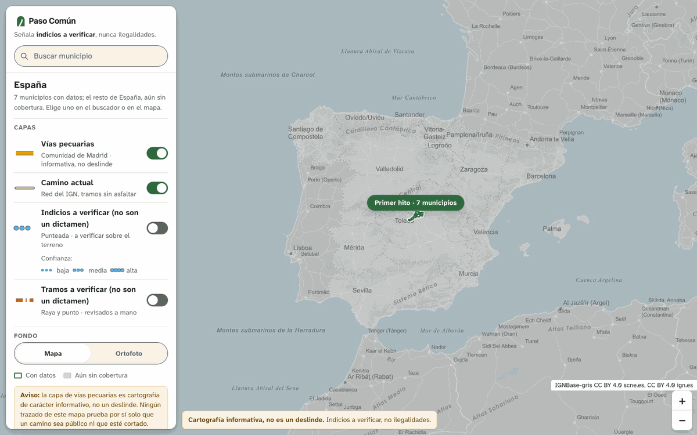 | 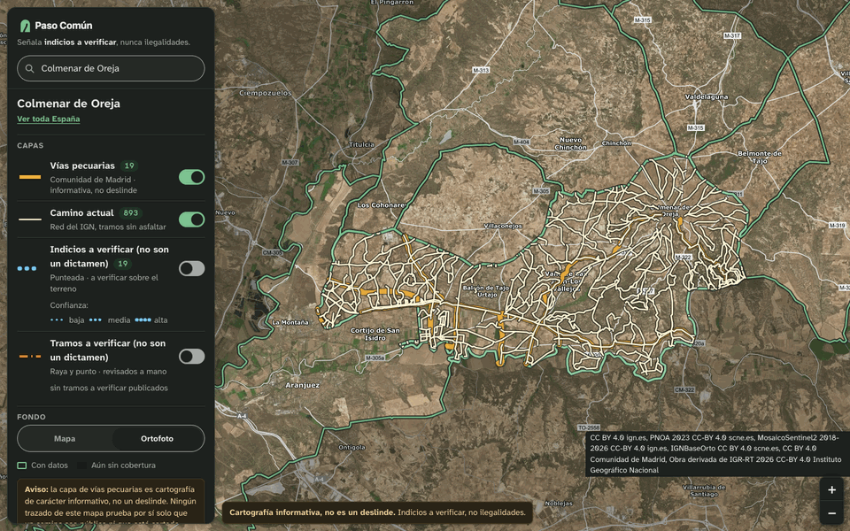 |

| Escritorio, ficha de un indicio (claro) | Escritorio, buscador (oscuro) |
|---|---|
| 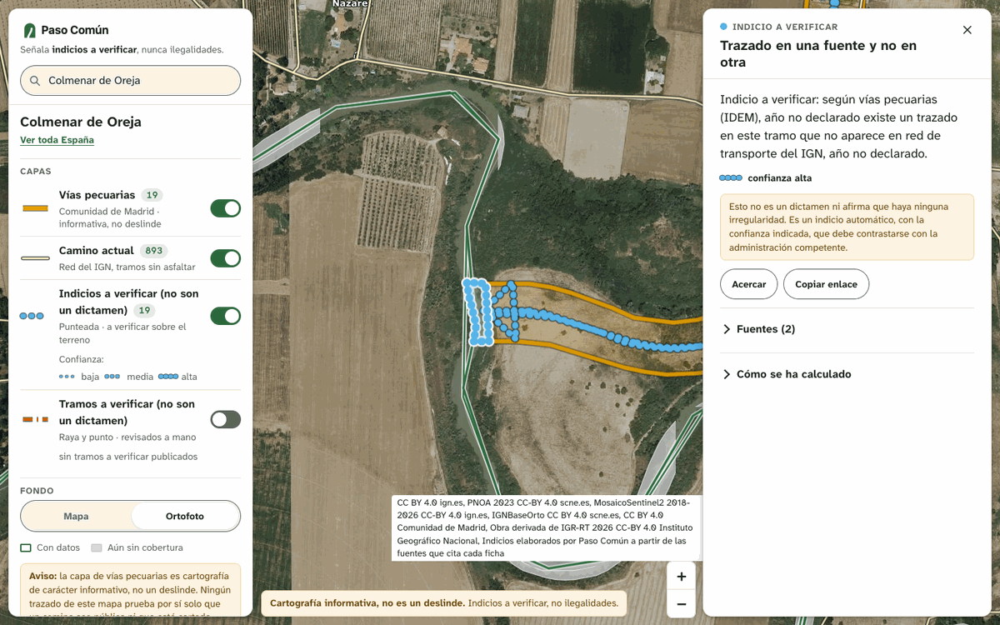 | 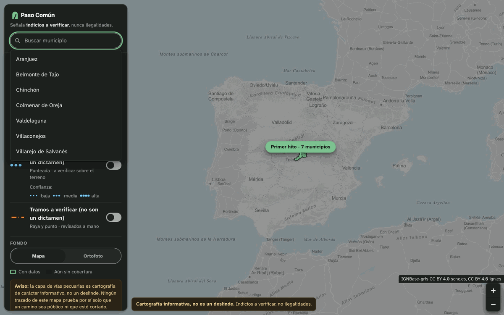 |

| Móvil, España (oscuro) | Móvil, capas (claro) | Móvil, ficha (claro) | Móvil, ficha (oscuro) |
|---|---|---|---|
| 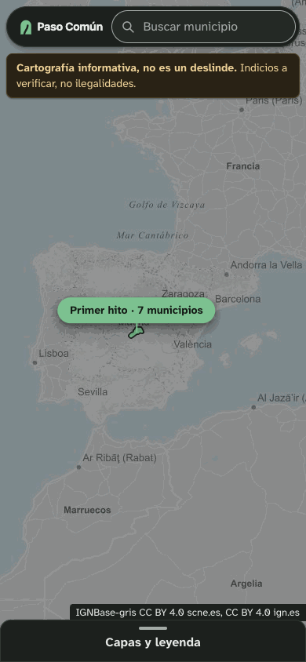 | 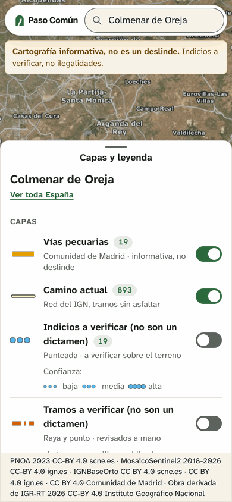 | 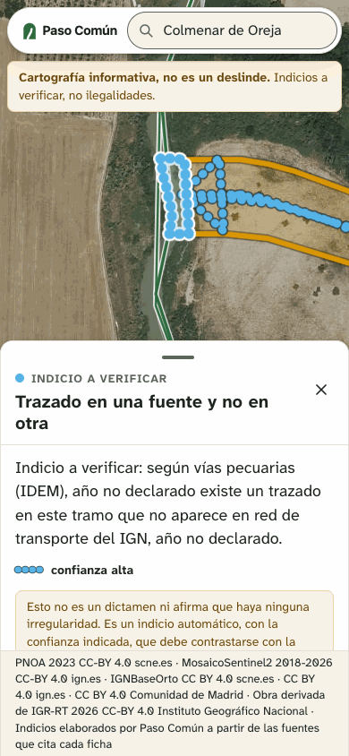 | 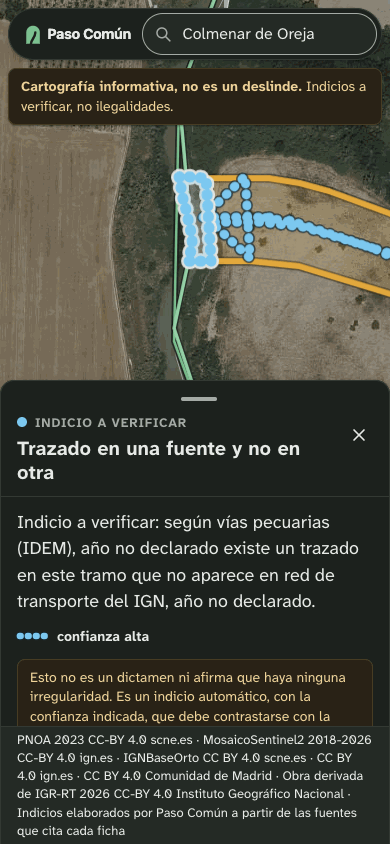 |
